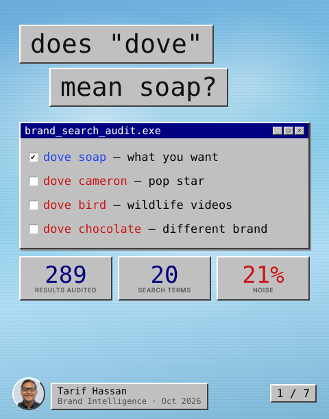
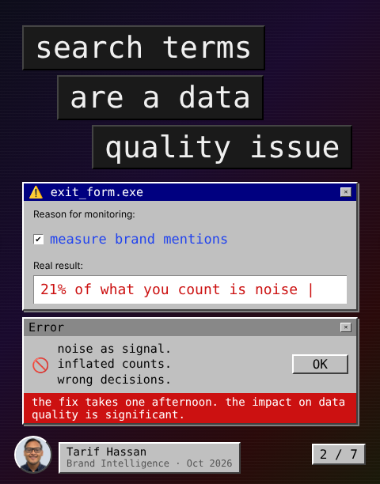
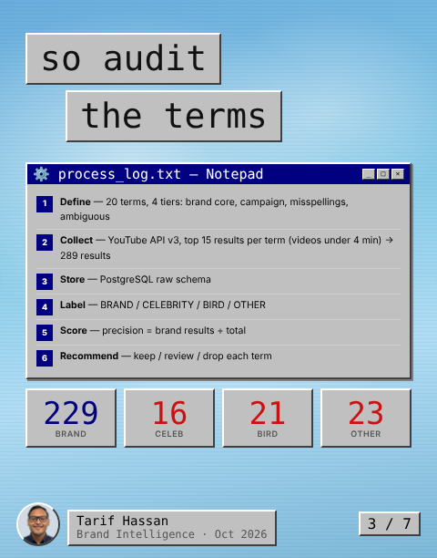
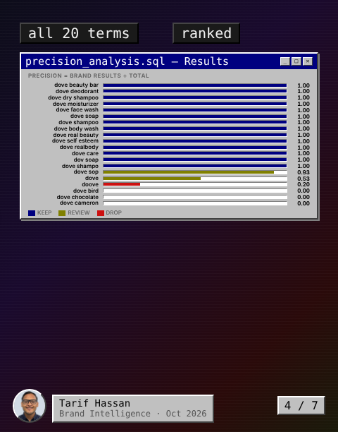
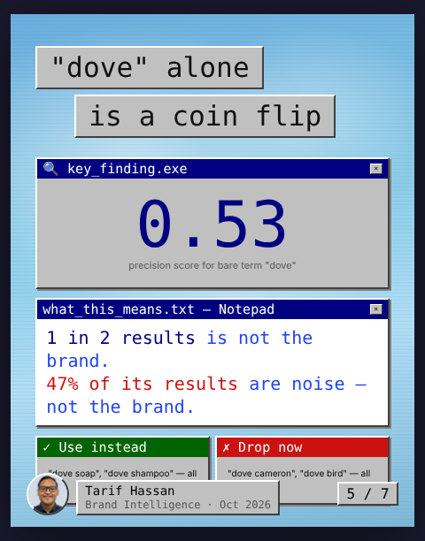
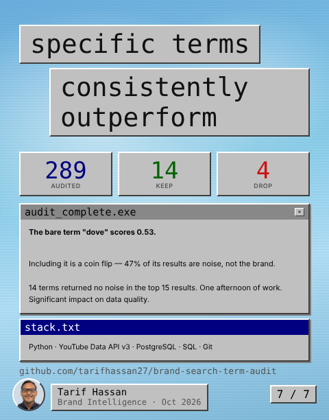

# Does "Dove" Mean Soap?
### A Brand Search-Term Audit — YouTube · 20 Terms · 289 Results

Brand monitoring tools count YouTube mentions by searching for keywords. But what if the keyword is ambiguous? **"Dove"** returns soap ads, Dove Cameron music videos, bird footage, and chocolate commercials. Without auditing which terms actually return brand content, a team could be measuring noise as signal.

Public data · YouTube Data API v3 · PostgreSQL / SQL analysis · Personal portfolio project

<p align="center"></p>

---

## The Problem

Brand teams search YouTube for "dove" and count everything as a brand mention. At 0.53 precision, the bare term is a coin flip — roughly half the results have nothing to do with Dove the beauty brand. On a high-volume campaign, that means a significant share of counted mentions is noise.

Full framing in [`01_business_problem/problem_statement.md`](01_business_problem/problem_statement.md).

<p align="center"></p>

---

## Methodology

<p align="center"></p>

1. **Define** — 20 search terms across 4 tiers: brand core, campaign, misspellings, ambiguous
2. **Collect** — YouTube Data API v3, top 15 results per term (videos under 4 minutes via `videoDuration=short`) → 289 results total
3. **Store** — PostgreSQL raw schema
4. **Label** — each result by title: BRAND / CELEBRITY / BIRD / OTHER
5. **Score** — precision = brand results ÷ total results per term
6. **Recommend** — keep / review / drop each term

Note: `videoDuration=short` returns videos under 4 minutes — not exclusively YouTube Shorts.

Data collection script in [`02_data/fetch_data.py`](02_data/fetch_data.py). Labeling rules in [`02_data/labeling_guideline.md`](02_data/labeling_guideline.md).

---

## Precision Results — All 20 Terms

<p align="center"></p>

| Search Term | Tier | Precision |
|---|---|---|
| dove soap | brand_core | 1.00 |
| dove shampoo | brand_core | 1.00 |
| dove deodorant | brand_core | 1.00 |
| dove body wash | brand_core | 1.00 |
| dove beauty bar | brand_core | 1.00 |
| dove dry shampoo | brand_core | 1.00 |
| dove moisturizer | brand_core | 1.00 |
| dove face wash | brand_core | 1.00 |
| dove real beauty | campaign | 1.00 |
| dove self esteem | campaign | 1.00 |
| dove realbody | campaign | 1.00 |
| dove care | campaign | 1.00 |
| dov soap | misspelling | 1.00 |
| dove shampo | misspelling | 1.00 |
| dove sop | misspelling | 0.93 |
| dove | ambiguous | 0.53 |
| doove | misspelling | 0.20 |
| dove bird | ambiguous | 0.00 |
| dove chocolate | ambiguous | 0.00 |
| dove cameron | ambiguous | 0.00 |

Full precision query in [`03_sql/03_precision_analysis.sql`](03_sql/03_precision_analysis.sql).

---

## Key Finding

<p align="center"></p>

**The bare term "dove" scores 0.53 precision.** Including it in brand monitoring is a coin flip — 47% of its results are noise, not the brand.

14 terms across brand_core, campaign, and misspelling tiers returned no noise in the top 15 results — precision 1.0 across the board.

---

## Recommendations

<p align="center"></p>

**Keep (14 terms, precision 1.0)** — All brand_core and campaign terms, plus `dov soap` and `dove shampo`. No noise in the top 15 results.

**Review (2 terms)** — `dove sop` (0.93, one stray result) and `dove` (0.53, half results are noise). Flag and monitor rather than include unfiltered.

**Drop (4 terms)** — dove cameron (0.00), dove bird (0.00), dove chocolate (0.00), doove (0.20). These return no brand content and pollute mention counts.

**Add (5 terms not yet monitored)** — dove body lotion, dove baby wash, dove men+care, dove deep moisture, dove antiperspirant.

Full playbook in [`05_taxonomy_playbook/taxonomy_playbook.md`](05_taxonomy_playbook/taxonomy_playbook.md).

---

## The Verdict

<p align="center"></p>

Specific terms consistently outperform in this sample. The fix is a one-time audit of the term list — one afternoon of work with a significant impact on data quality.

**Limitation:** Videos were labeled by title only. Title-based labeling can misclassify results where the title is ambiguous but the content is clearly brand-relevant (or vice versa). A tool that analyzes video content directly would close this gap.

**Full executive brief:** [`06_executive_brief/executive_brief.md`](06_executive_brief/executive_brief.md)
**Full presentation deck:** [`06_executive_brief/slides/dove-brand-search-audit.pdf`](06_executive_brief/slides/dove-brand-search-audit.pdf)

---

## Repo Structure

```
brand-search-term-audit/
├── 01_business_problem/
│   └── problem_statement.md
├── 02_data/
│   ├── fetch_data.py
│   ├── raw_results.csv
│   ├── labeling_guideline.md
│   └── labeled_results.csv
├── 03_sql/
│   ├── 01_create_tables.sql
│   ├── 02_load_raw.sql
│   └── 03_precision_analysis.sql
├── 05_taxonomy_playbook/
│   └── taxonomy_playbook.md
├── 06_executive_brief/
│   ├── executive_brief.md
│   └── slides/
│       ├── slide_01.png … slide_07.png
│       └── dove-brand-search-audit.pdf
└── test_search.py
```

**Tools:** Python · YouTube Data API v3 · PostgreSQL · SQL · Git

---

*Tarif Hassan — [LinkedIn](https://linkedin.com/in/tarifhassan27)*
